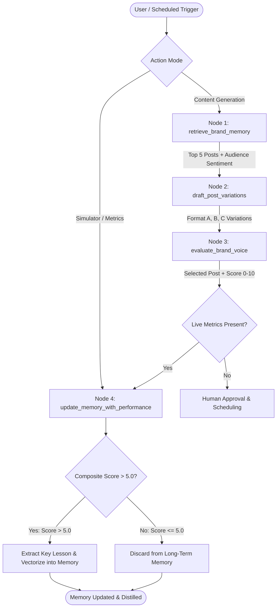

# SocioTrack: Social Media Engagement Agent

A production-grade, closed-loop Social Media Engagement Agent built with **Python 3**, **LangGraph**, **ChromaDB / Supabase pgvector**, **FastAPI**, and **Next.js 14**.

SocioTrack combines deterministic state machines with vector reinforcement learning to autonomously draft high-signal technical content, enforce brand voice guidelines, and learn from live post engagement metrics.

---

## Architecture Diagram



---

## 👥 Team Ownership & Modules

### **Person 1 (Agent & LangGraph Core)**
* **LangGraph StateGraph (`backend/app/core/agent.py`)**: Deterministic agent cycle generating 3 format variations (Data-first, Contrarian, Tactical breakdown) with voice compliance scoring.
* **Vector Memory Integration (`backend/app/core/memory.py`)**: Semantic memory retrieval and audience sentiment signals.
* **AI Diagnostics Brain & Audit**: Outlier detection math and automated creator audit reporting.

### **Person 2 (Backend API & Database Layer)**
* **PostgreSQL Schema (`backend/db/schema.sql`)**: Full DDL schema with `pgvector` (`vector(1536)`), enums, and indexes:
  - `brands`: Brand identity, voice descriptions, target audience.
  - `posts`: Full post lifecycle (`draft` → `pending_approval` → `scheduled` → `published`).
  - `post_analytics`: Impressions, likes, replies, shares, and weighted engagement scores.
  - `agent_memories`: Learned audience rules and insights synchronized with Hindsight memory banks.
* **FastAPI REST API Layer (`backend/app/routers/`)**:
  - `POST /api/generate-drafts`: Ingests `{ brand_id, topic }`, triggers agent workflow with Hindsight memory recall.
  - `POST /api/posts/approve`: Accepts `{ post_id, approved_content, scheduled_time }`, schedules post.
  - `GET /api/posts/queue`: Returns all scheduled and pending posts chronologically.
  - `POST /api/simulator/feed-metrics`: Accepts engagement metrics, calculates weighted score, triggers memory feedback loop.
  - `GET /api/memory/insights?brand_id={id}`: Returns learned audience insights.
  - `GET /api/brands` & `POST /api/brands`: Brand persona management for frontend selectors.
* **Hindsight Memory Client (`backend/app/services/hindsight_client.py`)**: Official integration for retain, recall, reflect.
* **Seed Data & Tooling (`backend/db/seed.py` / `seed.sql`)**: Pre-populated mock data for immediate testing.
* **Test Suite (`backend/tests/`)**: Unit & integration test coverage via pytest.

### **Person 3 (Frontend Architecture & Interactive SaaS UI)**
* **Design System & Visual Identity**: Microsoft Fluent-inspired light-theme palette (`#5146D8`, `#3478F6`, `#172033`, `#F6F7FB`, `#FFFFFF`, `#ECE9FF`, `#16A477`, `#718096`, `#E6E9F0`), Inter typography, custom SocioTrack neural logo.
* **Split-Screen Authentication (`frontend/src/components/auth/AuthPage.tsx`)**: Entry point with Login, Sign Up, and Password Reset screens; glowing 4-node AI illustration; Microsoft & Google SSO; instant demo access.
* **SocioTrack Intelligence Core (`frontend/src/components/IntelligenceCore.tsx`)**: Reactive 4-node cognitive visualization (Generation, Analysis, Memory, Prediction).
* **Generation Studio & Draft Queue (`frontend/src/components/GenerationStudio.tsx`, `DraftCard.tsx`)**: Multi-platform format selector, target tone, live inline editable textarea, character counter, predicted engagement meter, and collapsible AI explainability callout.
* **Agent Memory Panel (`frontend/src/components/AgentMemoryPanel.tsx`)**: 4 core insight cards (Contrarian 3.4x comparison bar chart, Peak reply window weekly timeline, Audience interest 68% circular progress, Learned preference) + force recalibration.
* **Live Engagement Lab (`frontend/src/components/LiveEngagementLab.tsx`)**: Expandable floating drawer with metric sliders, dynamic composite viral score formula, 5-step feedback loop animation, and instant dynamic insertion of newly discovered pattern card into Agent Memory.

### **Person 4 (Data Engineering & Presentation)**
* **Seed Dataset & Data Pipeline**: Structured JSON dataset with 15 posts and 6 memory rules.
* **Pitch Deck & Demo Assets (`presentation/`)**: Pitch deck PDF, demo script, and recorded demonstration.

---

## Repository Structure

```
social-engagement-agent/
├── .env.example                  # Centralized template for API keys & DB URLs
├── .gitignore
├── README.md                     # Run instructions & architecture diagram
│
├── backend/                      # Owned by Person 1 & Person 2
│   ├── app/
│   │   ├── main.py               # FastAPI app entry point & CORS
│   │   ├── config.py             # Pydantic Settings (ENV loading)
│   │   ├── core/
│   │   │   ├── agent.py          # Person 1: LangGraph StateGraph definition
│   │   │   ├── memory.py         # Person 1: Vector search & scoring algorithm
│   │   │   └── diagnostics_agent.py
│   │   ├── routers/              # FastAPI router endpoints
│   │   ├── models/               # SQLAlchemy ORM models
│   │   └── services/             # Agent workflow, engagement, hindsight client
│   ├── db/
│   │   ├── schema.sql            # PostgreSQL + pgvector schema
│   │   └── seed.py               # Database population script
│   ├── tests/                    # Pytest test suites
│   ├── requirements.txt
│   └── Dockerfile
│
├── frontend/                     # Owned by Person 3 (Frontend Architecture & UI/UX)
│   ├── src/
│   │   ├── app/
│   │   │   ├── layout.tsx
│   │   │   ├── page.tsx          # Main interactive container & auth flow
│   │   │   └── globals.css       # SocioTrack design tokens & Fluent styles
│   │   ├── components/
│   │   │   ├── auth/
│   │   │   │   └── AuthPage.tsx  # Split-screen: Login, Sign Up, Forgot Password
│   │   │   ├── SocioTrackLogo.tsx# Scalable neural network & sparkle SVG logo
│   │   │   ├── Sidebar.tsx       # Collapsible navigation, online status, user card
│   │   │   ├── Header.tsx        # Title, search, notifications, date, 4 metric cards
│   │   │   ├── IntelligenceCore.tsx # 4-node connected cognitive visualization
│   │   │   ├── GenerationStudio.tsx # Topic input, tone, platform, generate button
│   │   │   ├── DraftCard.tsx     # Live editable text, engagement meter, explainability
│   │   │   ├── AgentMemoryPanel.tsx # 4 insight cards, dynamic insertion, recalibration
│   │   │   ├── LiveEngagementLab.tsx# Floating drawer, metric sliders, 5-step feedback
│   │   │   ├── ExtraViews.tsx    # Queue, Audience Intel, Analytics, Settings
│   │   │   └── ui/               # shadcn components (button, card, dialog, etc.)
│   │   ├── lib/
│   │   │   ├── api.ts            # Client fetch wrappers pointing to backend
│   │   │   └── utils.ts
│   │   └── mocks/
│   │       └── mockData.ts       # Fallback JSON to unblock UI without backend
│   ├── public/
│   ├── package.json
│   ├── tailwind.config.js
│   └── tsconfig.json
│
└── presentation/                 # Presentation & Team Deliverables
    ├── agent1.md                 # Person 1: LangGraph & Memory specifications
    ├── agent1/README.md
    ├── agent3.md                 # Person 3: Complete UI/UX design system & frontend log
    ├── agent3/README.md
    ├── pitch_deck.pdf            # Slide deck PDF
    ├── demo_script.md            # Hackathon pitch & timed demo walkthrough
    └── demo_recording_link.txt   # Video recording link & timestamps
```

---

## Quickstart Instructions

### Option A: One-Command Docker Compose (Recommended)

```bash
# Start backend, frontend, and database
docker-compose up --build
```
- Dashboard: `http://localhost:3000`
- API Docs: `http://localhost:8000/docs`

### Option B: Terminal / Local Development

#### 1. Backend Setup (FastAPI & Agent)

```bash
# 1. Create and activate virtual environment
python3 -m venv .venv
source .venv/bin/activate

# 2. Install dependencies
pip install -r backend/requirements.txt

# 3. Seed database, vector store, and realistic posts
python backend/db/seed.py

# 4. Start FastAPI backend
uvicorn backend.app.main:app --reload --host 0.0.0.0 --port 8000
```
Interactive Swagger docs: `http://localhost:8000/docs`

#### 2. Frontend Setup (Next.js Dashboard)

```bash
cd frontend

# 1. Install frontend packages
npm install

# 2. Start Next.js development server
npm run dev
```
Dashboard will be live at `http://localhost:3000`.

---

## 📦 Seed Dataset

The repository includes both Python and SQL seeders (`backend/db/seed.py`, `backend/db/seed.sql`, and `backend/scripts/seed_data.json`) featuring:
- **5 High-Engagement Posts**: Contrarian technical hooks, code snippets, benchmark percentages.
- **5 Mediocre-Engagement Posts**: Generic announcements and links to blogs/webinars.
- **5 Poor-Engagement Posts**: Corporate jargon, buzzwords, and hashtag stuffing.
- **6 Structured Memory Rules**: High-confidence cognitive rules retained in Hindsight memory banks.

---

## 🧪 Running Tests

```bash
PYTHONPATH=backend pytest backend/tests
```

All unit and integration tests execute against the isolated in-memory vector store and PostgreSQL schema.
