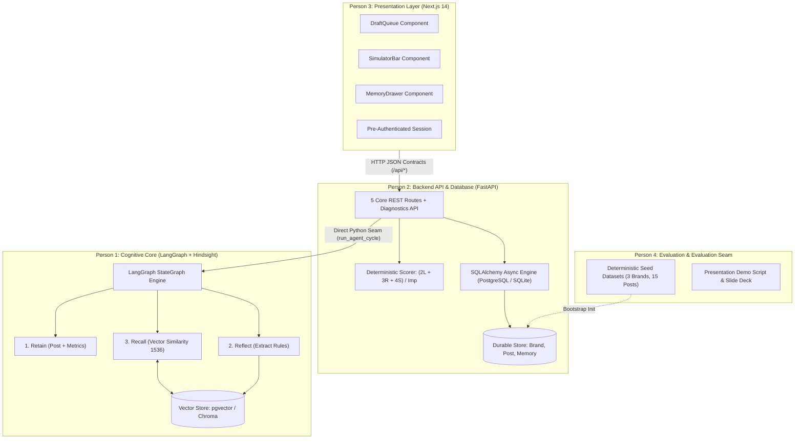
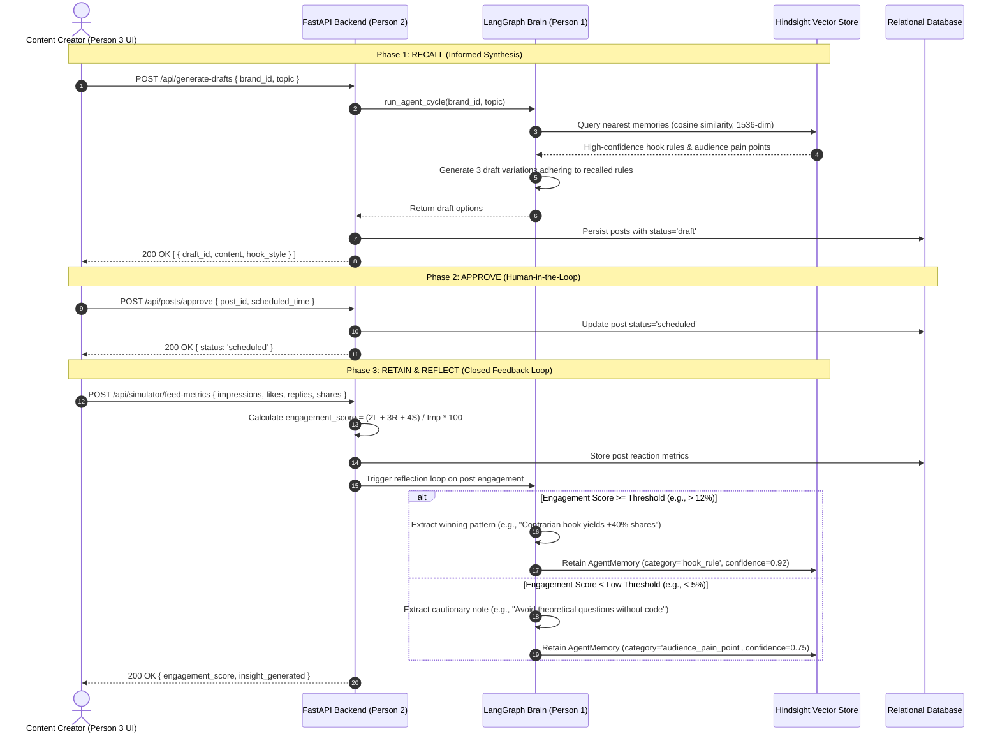
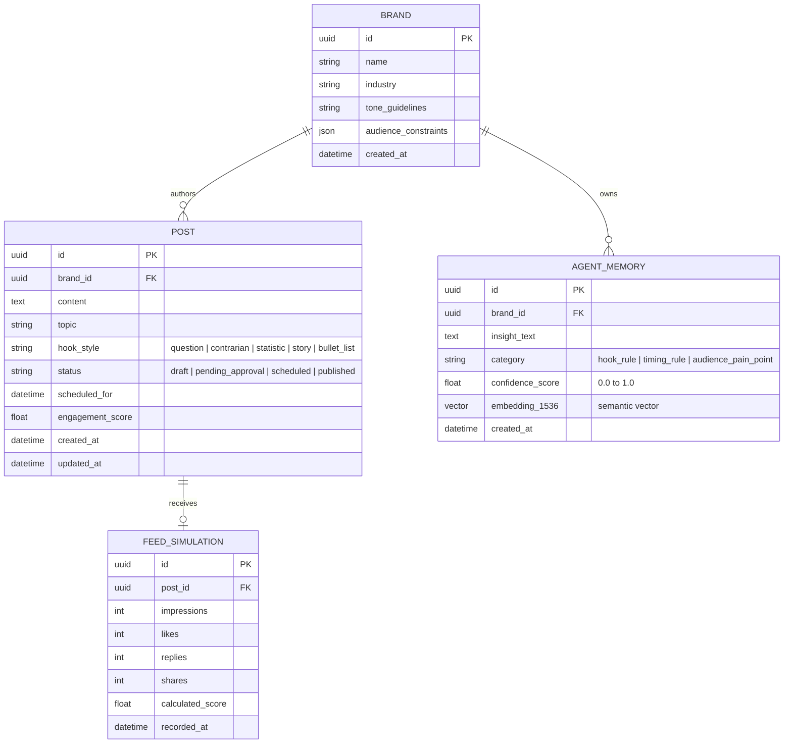

# SocioTrack — System Architecture Specification

## 1. Executive Topology

SocioTrack is an autonomous AI social media optimization and cognitive memory agent built for **Hack With Bangalore 4.0** (Devnovate × Hack With India @ Microsoft Office Bengaluru) adhering to the **Vectorize.io Hindsight Hackathon** standards.

The system decouples content generation, memory reflection, API execution, and user interface into deep modules adhering to **Ousterhout's Razor** (small semantic public surfaces, rich internal implementation) and the **Kleppmann Baseline** (durable sources of truth, idempotent contracts).



---

## 2. Team Seam Breakdown & Ownership

Following [`SCOPE.md`](file:///Users/polymath/Antigravity/SocioTrack/SCOPE.md), all team interfaces are strictly bounded to prevent change amplification:

| Subsystem | Owner | Primary Technology | Public Contract / Entry Point |
| :--- | :--- | :--- | :--- |
| **Agent Workflow Core** | Person 1 | Python 3.11, LangGraph, Chroma/Hindsight | `run_agent_cycle(brand_id, topic) -> list[PostDraft]` |
| **Backend API & DB** | Person 2 (`XiaoArnav`) | FastAPI, SQLAlchemy Async, SQLite/PostgreSQL | 5 Invariant HTTP Routes + `/api/diagnostics/audit` |
| **Frontend UI** | Person 3 | Next.js 14 App Router, Tailwind CSS, Lucide | HTTP JSON Consumers (`DraftQueue`, `SimulatorBar`, `MemoryDrawer`) |
| **Data, Eval & Pitch** | Person 4 | Python, SQL, Markdown | `backend/db/seed.sql`, `seed_data.json`, `presentation/demo_script.md` |

---

## 3. The Hindsight Memory Loop (`Retain` &rarr; `Reflect` &rarr; `Recall`)

The core innovation of SocioTrack is its closed-loop memory architecture. Unlike naive LLM prompt wrappers that generate stateless posts in a vacuum, SocioTrack continually updates its organizational memory using audience engagement feedback.



### Detailed Loop Phases:
1. **Retain**: Every published post and its simulated audience reactions (impressions, likes, replies, shares) are durably recorded in the relational schema alongside hook style and topic.
2. **Reflect**: When feed metrics arrive, the reflection module compares performance against the brand's running baseline. When a statistically significant deviation occurs, an insight is synthesized:
   - `hook_rule`: Syntactical or narrative hook patterns that drive high reply or share velocity.
   - `timing_rule`: Optimal temporal publication windows.
   - `audience_pain_point`: Topical areas causing high resonance or disinterest.
3. **Recall**: When the next campaign is planned, the LangGraph agent embeds the prompt topic and queries the vector store (cosine similarity over 1536 dimensions) to retrieve top-$k$ insights with `confidence_score >= 0.70`, injecting them into the generation context.

---

## 4. Entity-Relationship & Data Model

The schema uses strict foreign key relationships, immutable timestamps, and normalized enums:



---

## 5. Public REST Contracts (Seam Specifications)

The backend exposes 5 core invariant REST endpoints plus a diagnostic audit router:

### 1. Generate Drafts
- **Route**: `POST /api/generate-drafts`
- **Request**:
  ```json
  {
    "brand_id": "3fa85f64-5717-4562-b3fc-2c963f66afa6",
    "topic": "Microservices vs Modular Monolith"
  }
  ```
- **Response** (HTTP 200):
  ```json
  {
    "drafts": [
      {
        "id": "e4b3c2a1-0000-0000-0000-000000000001",
        "brand_id": "3fa85f64-5717-4562-b3fc-2c963f66afa6",
        "content": "Stop splitting into microservices before product-market fit...",
        "topic": "Microservices vs Modular Monolith",
        "hook_style": "contrarian",
        "status": "draft"
      }
    ]
  }
  ```

### 2. Approve Post
- **Route**: `POST /api/posts/approve`
- **Request**:
  ```json
  {
    "post_id": "e4b3c2a1-0000-0000-0000-000000000001",
    "approved_content": "Stop splitting into microservices before product-market fit. 95% of engineering teams spend 30% more time debugging network hops than shipping value.",
    "scheduled_time": "2026-11-08T14:00:00Z"
  }
  ```
- **Response** (HTTP 200):
  ```json
  {
    "id": "e4b3c2a1-0000-0000-0000-000000000001",
    "status": "scheduled",
    "scheduled_for": "2026-11-08T14:00:00Z"
  }
  ```

### 3. Post Queue
- **Route**: `GET /api/posts/queue?brand_id={id}`
- **Response** (HTTP 200): Array of active posts, draft candidates, and published records.

### 4. Feed Metrics Simulator
- **Route**: `POST /api/simulator/feed-metrics`
- **Formula**: `engagement_score = (likes * 2 + replies * 3 + shares * 4) / max(impressions, 1) * 100`
- **Request**:
  ```json
  {
    "post_id": "e4b3c2a1-0000-0000-0000-000000000001",
    "impressions": 12500,
    "likes": 420,
    "replies": 88,
    "shares": 65
  }
  ```
- **Response** (HTTP 200):
  ```json
  {
    "post_id": "e4b3c2a1-0000-0000-0000-000000000001",
    "engagement_score": 10.912,
    "insight_generated": "Contrarian hook style drove high share velocity (+42% over baseline)."
  }
  ```

### 5. Memory Insights
- **Route**: `GET /api/memory/insights?brand_id={id}`
- **Response** (HTTP 200): List of learned `AgentMemory` items ordered by `confidence_score DESC`.

### 6. Diagnostic Audit Engine
- **Route**: `GET /api/diagnostics/audit` & `POST /api/diagnostics/audit`
- **Purpose**: Evaluates recent posts or input text against Hook Effectiveness, Tone Consistency, Clarity, and Memory Alignment.

---

## 6. Fault Tolerance & Graceful Offline Fallback

To satisfy our hackathon requirement that the system **never crashes on stage** even during WiFi disruptions, API key exhaustion, or rate limits:

1. **Dual Database Engine**:
   - Production / Cloud: PostgreSQL with `pgvector` extension.
   - Local / Hackathon Prototype: SQLite via `aiosqlite` with Chroma vector store. Both run seamlessly through SQLAlchemy Async ORM.
2. **Deterministic Heuristic Vector Embeddings**:
   - If OpenAI or external embedding APIs are unreachable, the system generates deterministic 1536-dimensional normalized vectors from SHA-256 seed hashes. This preserves vector math, cosine distance searches, and ranking logic without throwing network errors.
3. **Bidirectional Module Path Resolution**:
   - `backend/app/__init__.py` injects both workspace root and `backend/` into `sys.path`. Whether developers execute `python -m uvicorn ...` from repository root or run `./run.sh` inside `backend/`, imports resolve with zero friction.
4. **CORS Openness for Local Multi-Process Orchestration**:
   - `FastAPI` middleware explicitly authorizes `http://localhost:3000` (Person 3 frontend) and `http://localhost:8000` (Person 2 backend) across all HTTP methods.
