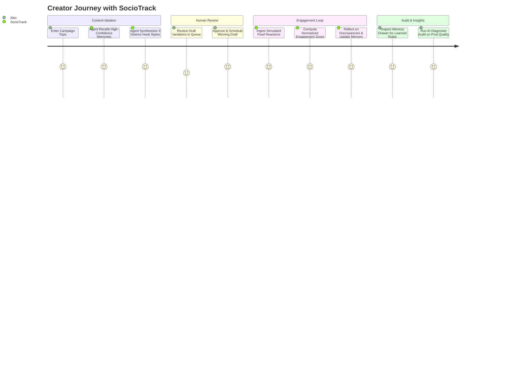

# SocioTrack — Product Requirements Document (PRD)

| Metadata | Details |
| :--- | :--- |
| **Product Name** | **SocioTrack** — Autonomous Social Media Engagement Agent with Persistent Memory |
| **Hackathon Target** | **Hack With Bangalore 4.0** (Devnovate × Hack With India @ Microsoft Office Bengaluru) |
| **Hackathon Track** | **Vectorize.io Hindsight Track** (Memory Retention & Reflection) |
| **Target Stage** | Live Stage Prototype & Production Candidate |
| **Status** | **APPROVED / LOCKED** |

---

## 1. Problem Statement & Opportunity

### The Modern Social Content Paradox
Modern social media management tools (Buffer, Hootsuite, Sprout Social) are passive scheduling queues: they broadcast text but possess zero intelligence regarding audience resonance. Conversely, generative AI tools (ChatGPT, Jasper) are stateless text generators: they produce generic drafts in a vacuum, suffering from:

1. **Amnesia Across Campaigns**: LLMs do not remember which hook styles drove conversations last month versus which triggered high churn.
2. **Disconnected Feedback Loops**: There is no automated bridge connecting social engagement metrics (replies, shares, likes) back into prompt reasoning.
3. **Loss of Brand Voice**: Without structured memory boundaries, generated drafts drift into generic marketing clichés.
4. **Lack of Human Agency**: Completely autonomous publishing risks brand reputation, while entirely manual authoring burns out creators.

### The SocioTrack Solution
SocioTrack bridges this divide by pairing a **LangGraph StateGraph Engine** with the **Vectorize.io Hindsight Memory Loop** (*Retain* &rarr; *Reflect* &rarr; *Recall*). SocioTrack acts as an autonomous, persistent creative partner that remembers what works for each brand, suggests diverse hook styles, incorporates human approval, and continuously learns from audience reactions.

---

## 2. Target Personas

### Primary Persona: Alex Chen — Principal Content Architect
- **Profile**: Lead content strategist at an enterprise developer tools / B2B SaaS startup.
- **Pain Points**:
  - Overwhelmed by the need to publish 15+ insightful posts weekly across technical domains.
  - Frustrated when team members or generic AI tools write shallow "guru-style" posts that tech audiences mock.
  - Lacks time to manually calculate correlation between hook formats and long-term reach.
- **Goals with SocioTrack**:
  - Autonomously generate 3 high-quality technical drafts per topic grounded in past winning hooks.
  - Approve or tweak drafts in seconds before scheduling.
  - Review the agent's memory bank to understand what the audience actually cares about.

### Secondary Persona: Elena Rostova — Growth Marketer & Founder
- **Profile**: Solo founder or seed-stage growth lead managing social marketing across multiple business lines.
- **Goals with SocioTrack**:
  - Switch between distinct brand identities (FinTech, SaaS, Health/Wellness) without voice bleeding.
  - Simulate engagement before committing marketing spend or key launch announcements.

---

## 3. Core User Journeys

---

## 4. Functional Requirements (FR)

### FR-1: Brand Identity & Knowledge Boundary
- The system must support isolated brand profiles with predefined industry guidelines, audience constraints, and target tone guidelines.
- Seed data must provide 3 production-ready profiles:
  1. **DevFlow Analytics** (Enterprise SaaS / Developer Infrastructure)
  2. **PulseBio** (HealthTech & Longevity Science)
  3. **ApexCapital** (FinTech & Algorithmic Markets)

### FR-2: Agentic Multi-Hook Generation (LangGraph)
- Given a `brand_id` and a `topic`, the agent must retrieve past high-confidence memories and synthesize 3 candidate drafts across contrasting hook styles:
  - `contrarian` (challenges conventional wisdom)
  - `question` (prompts discussion or architectural debate)
  - `statistic` (data-backed case study)
  - `story` (first-person narrative or milestone)
  - `bullet_list` (actionable playbook)
- Each candidate draft must be stored with status `draft`.

### FR-3: Human-in-the-Loop Editorial Approval
- Users must be able to review generated candidates, modify text if needed, specify target publication timestamps, and promote the post to `scheduled`.
- The system must prevent unapproved drafts from advancing to published state.

### FR-4: Real-Time Feed Reaction Simulator
- Because real social platforms prohibit automated spamming during hackathons, the system must provide a deterministic Feed Reaction Simulator.
- Ingestion endpoint `POST /api/simulator/feed-metrics` receives `impressions`, `likes`, `replies`, and `shares`.
- Normalized metric formula:
  $$\text{Engagement Score} = \frac{\text{Likes} \times 2 + \text{Replies} \times 3 + \text{Shares} \times 4}{\max(\text{Impressions}, 1)} \times 100$$

### FR-5: Vectorize.io Hindsight Memory Loop
- **Retain**: Persist engagement feedback and post metadata.
- **Reflect**: Trigger cognitive reflection when a post finishes simulation:
  - Engagement $\ge$ threshold $\implies$ extract positive `hook_rule` or `timing_rule`.
  - Engagement $<$ baseline $\implies$ extract negative insight or `audience_pain_point`.
- **Recall**: Vector embeddings (1536 dimensions) stored in pgvector / Chroma. Cosine similarity matches future topic queries to inject top memories into generation prompts.

### FR-6: Creator Quality Diagnostic Audit
- Diagnostic endpoint (`GET /api/diagnostics/audit` and `POST /api/diagnostics/audit`) evaluating post content across 4 core axes:
  1. *Hook Effectiveness* (0–10)
  2. *Tone Consistency* (0–10)
  3. *Clarity & Brevity* (0–10)
  4. *Memory Alignment* (0–10)
  - Returns a composite score and actionable suggestions for editorial improvement.

---

## 5. Non-Functional Requirements (NFR)

- **NFR-1: Zero Stage Crashes (100% Demo Uptime)**:
  - If network access to external LLM providers is interrupted, the agent must gracefully fall back to deterministic template heuristics and local SHA-256 normalized vector embeddings.
- **NFR-2: Latency**:
  - API endpoint response times for cached drafts and memory queries must be under **200ms**.
  - Draft generation in demo mode must complete in under **1.5s**.
- **NFR-3: Zero-Friction Presentation Mode**:
  - The frontend application (`http://localhost:3000`) must load directly into an authenticated session (Alex Chen, Principal Content Architect) without requiring manual login credentials on stage.
- **NFR-4: Clean Public Seam Isolation**:
  - Person 1, Person 2, Person 3, and Person 4 codebases must strictly interact through documented interfaces ([`SCOPE.md`](file:///Users/polymath/Antigravity/SocioTrack/SCOPE.md)). No monkey-patching or circular cross-module imports.
- **NFR-5: Test Verification**:
  - The repository must maintain 100% passing automated test suites (`backend/tests/`) with zero warnings.

---

## 6. Judging Criteria & Hackathon Alignment

| Judging Axis | How SocioTrack Exceeds the Bar |
| :--- | :--- |
| **Vectorize.io Hindsight Memory Track** | Complete, bi-directional memory loop (*Retain* &rarr; *Reflect* &rarr; *Recall*) using 1536-dimensional vector search. Demonstrates clear delta in post quality when memories are active vs inactive. |
| **Technical Complexity & Architecture** | LangGraph cyclical state graphs, FastAPI async SQLAlchemy engine, Next.js 14 App Router, and strict Pocock-OS deep module engineering. |
| **Product Usability & Design** | Sleek dark-mode dashboard with interactive metric sliders, real-time engagement score calculations, and visual memory drawer. |
| **Presentation Readiness** | Rehearsed 3-minute stage pitch script ([`presentation/demo_script.md`](file:///Users/polymath/Antigravity/SocioTrack/presentation/demo_script.md)), deterministic seed data, and 0-click login. |
