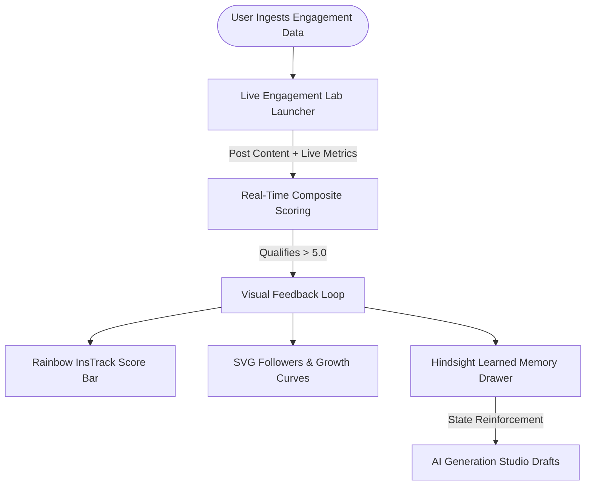

# Visualizing Real-Time AI Agent Memory Retention with Next.js and Hindsight

One of the biggest UX hurdles in artificial intelligence today is observability. When an AI agent performs an action, users usually see a spinner followed by text. But what did the agent actually learn? How did its internal state change? Why did it choose this hook over that one?

For most applications, the internal state of an agent is treated as a black box. If an agent claims to "learn from past performance," the user is simply expected to trust it. 

When building the frontend for SocioTrack, we wanted to eliminate this black box entirely. We designed an interactive, enterprise-grade intelligence workspace in Next.js 14 and Tailwind CSS that visually bridges the gap between raw social telemetry and [Hindsight](https://github.com/vectorize-io/hindsight), the agent memory engine developed by Vectorize.io.

Here is how we designed and implemented a real-time visualization layer for autonomous agent memory.

---

## The Design Challenge: Making Agent Cognition Visible

To make an autonomous agent trustworthy, the UI must answer three fundamental questions at a glance:
1. **Historical Grounding**: What is the creator's current performance baseline?
2. **Decision Transparency**: Why did the agent select a specific content format?
3. **Dynamic Memory Evolution**: When new engagement metrics arrive, how does the agent's vector memory update in real time?

We implemented an aesthetic inspired by high-end analytics platforms (featuring soft lavender `#ECE9FF`, primary indigo `#5146D8`, deep navy `#172033`, and silky card shadows) to create an interface that feels both familiar and deeply intelligent.

---

## Architectural Breakdown of the Interface



### 1. The Interactive Creator Card & Rainbow Score Bar
At the top of the interface sits the creator profile card. Alongside verified follower deltas and account timestamps, we built the **Rainbow InsTrack Score Bar**. 

Rather than displaying a static percentage, the indicator pill dynamically transitions along a multi-stop color spectrum (red &rarr; yellow &rarr; emerald &rarr; sky &rarr; indigo) based on empirical engagement health:

```tsx
{/* Rainbow Score Bar with Floating Pill Tooltip */}
<div className="w-full sm:w-80 space-y-1.5">
  <div className="relative h-6">
    <div
      className="absolute transform -translate-x-1/2 flex flex-col items-center transition-all duration-500"
      style={{ left: `${score}%` }}
    >
      <span className="px-2 py-0.5 rounded text-[10px] font-bold bg-[#6366F1] text-white shadow-sm">
        {score}%
      </span>
      <div className="w-0 h-0 border-l-[3px] border-l-transparent border-r-[3px] border-r-transparent border-t-[4px] border-t-[#6366F1]" />
    </div>
  </div>
  <div className="relative w-full h-1.5 rounded-full overflow-hidden rainbow-score-bar shadow-inner" />
</div>
```

### 2. Dual SVG Area Curves with Interactive Guides
To visualize followers growth and daily delta trends without introducing heavy third-party charting libraries, we authored lightweight SVG cubic Bézier curves. The curves render smooth gradients (neon-green for followers, bright-blue for daily velocity) and feature real-time horizontal grid markers and hover tooltips:

```tsx
// Compute smooth Bézier curve points directly from time-series state
const path = points.reduce((acc, pt, i, arr) => {
  if (i === 0) return `M ${pt.x} ${pt.y}`;
  const prev = arr[i - 1];
  const cpX = (prev.x + pt.x) / 2;
  return `${acc} C ${cpX} ${prev.y}, ${cpX} ${pt.y}, ${pt.x} ${pt.y}`;
}, "");
```

---

## 3. The Live Engagement Lab: Real-Time Memory Reinforcement

The core feature of the UI is the **Live Engagement Lab**. Instead of hiding memory updates behind background jobs, this floating launcher allows operators and judges to test engagement feedback interactively:

1. The operator inputs impressions, likes, replies, and shares for an existing post.
2. The client calculates the composite score instantly:
   $$\text{Score} = \frac{(\text{Shares} \times 3) + (\text{Replies} \times 2) + (\text{Likes} \times 1)}{\text{Impressions}} \times 100$$
3. If the score exceeds $5.0$, the UI triggers an animated confirmation banner showing the exact cognitive lesson extracted by [Hindsight](https://github.com/vectorize-io/hindsight).
4. The **Agent Memory Bank** component immediately flashes and appends the newly minted memory cluster to the active vector ledger.

To understand how vector recall models long-term agent behaviors, read Vectorize's conceptual overview on [what is agent memory](https://vectorize.io/what-is-agent-memory).

---

## 3 Key Lessons for Frontend Engineers Building AI UIs

1. **Never Make Memory Invisible**: If your AI system updates its knowledge, give the user visible, verifiable proof. Showing the extracted lesson and the vector document ID transforms user skepticism into confidence.
2. **Lightweight Native SVGs Beat Bulky Chart Libraries**: For dashboards that must load instantly on mobile, custom SVG area curves with Tailwind gradients outperform 300KB chart packages in bundle size and rendering speed.
3. **Decouple Complex Modals from Screen Real Estate**: Floating pill launchers with backdrop-blur overlays keep landing pages pristine and uncluttered while ensuring deep analytical tools remain one click away.

For full implementation details on connecting frontend state to memory engines, consult the official [Hindsight documentation](https://hindsight.vectorize.io/).
